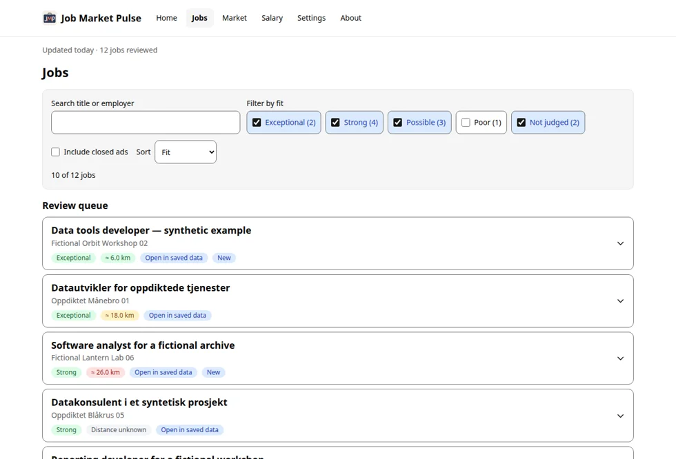
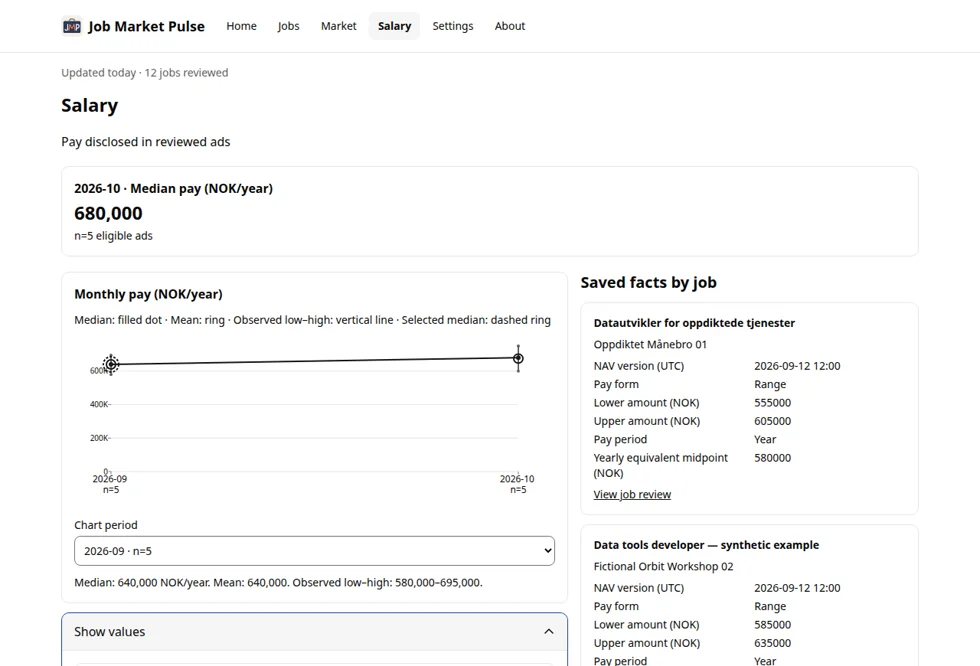
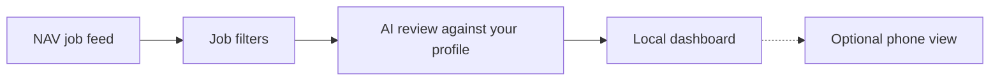

# Job Market Pulse

Find jobs in Norway that fit your profile and review them on your computer.

## What you get



**Jobs:** Review saved jobs with a fit level and a distance tag for each job.



**Salary:** See pay stated in reviewed ads and, for months with at least five eligible ads, the median, mean and range of yearly pay midpoints. The demo figures are invented, not market estimates.

## Requirements

Install Git, [Bun 1.4.4](https://bun.sh/docs/installation) and
[Node.js 22.17 or newer](https://nodejs.org/en/download) on Linux. Make sure
`git --version`, `bun --version` and `node --version` work in your terminal.
You only need a signed-in Pi or Claude Code session for AI review. No NAV
account is needed.

The setup below is for Linux. Windows has [offline CI checks](docs/operations/short-cli.md#windows-refresh-and-failure-reports),
not native installer or live refresh acceptance. macOS is untested. The app
menu launcher is Linux-only.

## Install

```bash
git clone https://github.com/MrAldrin/job-market-pulse.git
cd job-market-pulse
```

To try the invented jobs first, install the dependencies and build the app:

```bash
bun install --frozen-lockfile
bun run build
bun src/cli/pulse.ts demo
```

Open the URL in your terminal output. Press `Ctrl+C` to stop. Install can
contact package registries; the demo itself needs no profile, sign-in or
external service. If you only want to test the demo, stop here.

To set up your own profile, run `bun run setup` in the checkout. The wizard
asks for your profile, postcode, search radius and AI reviewer. Quick postcode
setup can contact Kartverket. On Linux the wizard can also add an app menu entry. Use the short form or defer the AI interview
to set up without a model call. Before you select **Run**, read the [NAV API terms](https://arbeidsplassen.nav.no/vilkar-api)
and make sure you are ready to contact NAV and your AI service. Use of the NAV
feed means that you agree to its terms. See the [setup guide](docs/quickstart.md).

## Use

1. **Open the app and select Run.** Open Job Market Pulse from your app menu,
   or run `bun src/cli/pulse.ts dashboard` and open the printed URL. To refresh
   from the terminal instead, run `bun src/cli/pulse.ts refresh --no-publish`.
2. **Review jobs.** **Home** shows your shortlist. **Jobs** shows all reviewed
   jobs with a fit level and a distance tag. Star or react to jobs to keep track.
3. **Refresh later.** Select **Run** again. Change your search in **Settings**.

## How it works



Pulse runs on your computer. A refresh reads NAV and sends job and profile
text to your AI service. No hosting is needed. For an
[optional phone view](docs/dashboard/phone-view.md), use Tailscale Serve or
upload a read-only copy to Railway.

[Setup guide](docs/quickstart.md) · [Commands](docs/operations/short-cli.md) ·
[All docs](docs/index.md)
