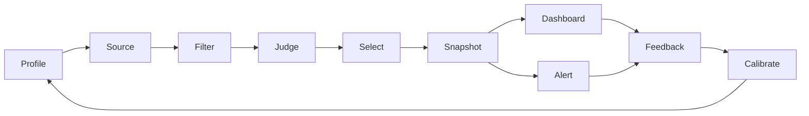

# Pipeline bricks

## Three layers

1. **Alert:** send a short message when there is a new exceptional match.
2. **Dashboard:** show saved jobs and market information.
3. **Feedback loop:** record feedback for a later profile correction.

These are product goals, not a claim that scheduled alerts or automatic profile
correction run today. See the [product goal](../product-goal.md) and
[scope and verification limits](../scope.md).

## Brick chain

| Brick | Responsibility |
| --- | --- |
| Profile | Load personal settings, text and limits. |
| Source | Read bounded source changes and resolve location evidence. |
| Filter | Apply geography, occupation and exclusion rules. |
| Judge | Compare candidates and ad text with the profile. |
| Select | Choose evidence-supported recommendations. |
| Snapshot | Capture saved results and settings, including private review inputs. |
| Dashboard | Display snapshots and provide separate feedback and local refresh controls. |
| Alert | Prepare and send notifications. |
| Feedback | Record explicit ratings and reactions. |
| Calibrate | Prepare a profile correction proposal for approval. |

The [module map](module-map.md) identifies TypeScript owners. The
[contracts](contracts.md) document boundary data. The offline oracle uses
stored synthetic comparison inputs and outputs.

## Rules

- Filter removes jobs; deterministic relevance evidence is not personal fit.
- Judge is the only brick that calls a model in the normal run.
- Dashboard result views read snapshots, including captured settings. The local
  editor uses the separate [Profile settings boundary](../../contracts/local-settings-api.md).
  ntfy uses saved snapshots for job content. The separate staged Discord path uses digest inputs.
- A brick must not read another brick's private tables. Existing shared source
  schema coupling remains; see [pipeline seams](../pipeline/pipeline-seams.md).
- Keep feedback writes separate from snapshot reads. A view never refreshes the
  source, starts model work or changes the profile. The separate
  [local run API](../../contracts/local-run-api.md) starts a refresh only after
  confirmation in the selected local dashboard.

## TypeScript structure

- Use the pinned Bun version and lock file. TypeScript is strict. Use Effect 3 with compatible platform dependencies and Effect Schema for brick contracts.
- Keep pure rules separate from I/O. Use tagged errors and Effect services with Layers. Use the single SvelteKit ManagedRuntime in `src/lib/server/runtime.ts`; components receive page data, not Effect programs.
- Select SQLite resources by path and mode. Each resource owns its connection and transaction context. Read-only snapshots do not initialize databases. Write transactions use `BEGIN IMMEDIATE`; nested transactions use savepoints. Resource acquisition does not enable WAL.
- Use the Effect Clock and explicit Oslo formatting. Test with synthetic inputs and injected resource Layers. Use fast-check for pure rules.
- Run `bun run check`: types, lint, fast tests, a small saved-output comparison and the separate Bun harness tests. Aim for under 20 seconds for `bun run test:fast`. For relevant browser changes use the separate `bun run test:slow` gate with the pinned local Chromium cache.
- Add new server, contract and CLI modules to the [module map](module-map.md).
