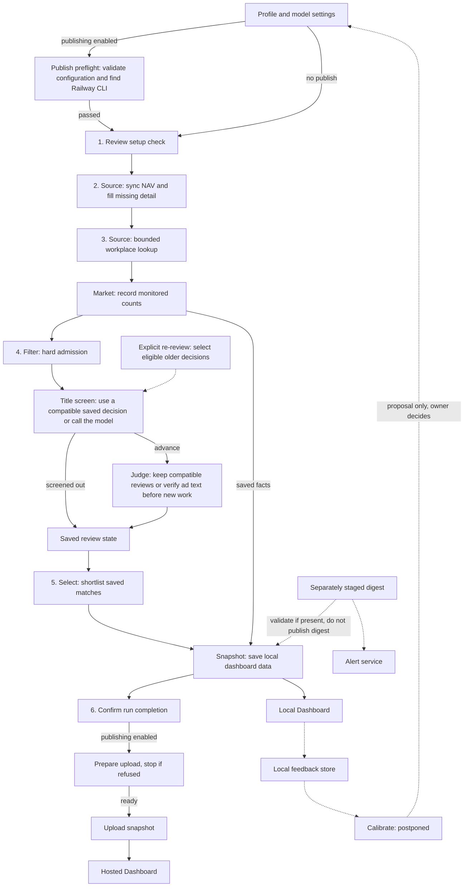
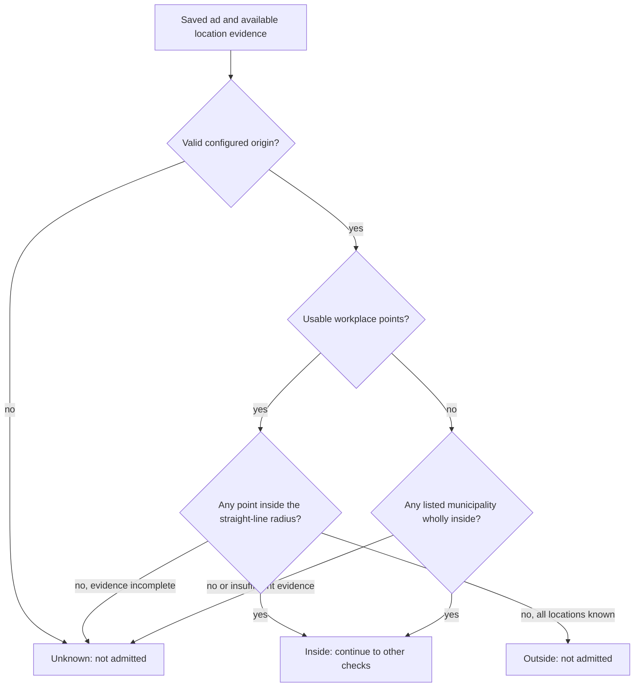

# Follow a Pulse refresh

A refresh checks setup, reads the source, reviews candidates and saves a local
snapshot. Upload is separate and opt-in. See [local pipeline operations](../operations/local-pipeline.md)
for commands and retry behavior.

## Run map

Solid arrows show the current refresh. Dashed arrows show separate operations or
intended paths.

## What each stage uses and leaves behind

Profile files in the table are relative to `local_only/profiles/<id>/` unless
shown otherwise. **Captured** means read-only values from the saved snapshot.
**Current** means the local editor for the next run. Saving an edit does not
change the captured values. See [Dashboard Settings](../dashboard/new-dashboard.md#captured-settings)
and the [current editor](../dashboard/new-dashboard.md#current-local-settings).

| Stage | Input → output | Settings file and Settings page |
| --- | --- | --- |
| Before 1. Publish preflight | If `--no-publish` is not set, check `publish.toml` when present. Look for Railway only if an upload is configured. Invalid settings or a missing CLI when required stop the run before the pipeline. This check does not prepare an upload. | `local_only/publish.toml` supplies publish settings. |
| 1. Profile and review setup | Load the selected profile and settings under locks. Validate review options, writable directories and the configured screening and judging harnesses. A failed check stops the stages; this check is not a model review. | `profile.toml` selects paths and policy. The narrative defaults to `profile.md`. `filters.toml`, `screen.toml`, `judge.toml` and `local_only/models.toml` supply the rules and models below. Captured **Schedule** and Current **Local schedule** use `profile.toml`; the schedule does not gate a manual run. |
| 2. [Source sync](nav-reader.md#source-service) | Read bounded NAV feed pages from the saved cursor. Apply events to the selected Source SQLite store; inactive ads leave the current set. Fetch active detail within budget; missing details can remain. After catching up, rank saved ads with missing details for another bounded fetch. Source returns page and event counts, not a candidate manifest. | `profile.toml` selects the source DB. `filters.toml`, `screen.toml` and `judge.toml` inform detail ordering, not a profile-wide gate on incoming events. Captured **Sources** shows NAV and maximum source age, not the cursor, DB path or request budget. There is no separate FINN connector; ingest does not test each NAV payload's `source` field against a FINN deny list. |
| 3. [Workplace lookup](location-resolution.md) | Take saved ads that pass early occupation and exclusion rules and lack complete, current workplace evidence. Read matching NAV detail and look up a unique address and postcode with Kartverket. Save approximate points with version evidence when found, plus a checkpoint for the bounded walk. Return attempted, resolved and unknown ad counts. | `filters.toml` and `screen.toml` supply candidate rules. Captured **Search filters**, **Title screening rules** and **Personal review inputs** show related inputs, not the lookup checkpoint or budget. |
| Before 4. [Market](market.md) | Read saved Source facts and record two series: source-wide titles and profile-filtered detail. Record text and occupation coverage for the detailed series. This stage does not fetch ad text. A Market failure gives a warning; review can continue. | Market is off unless an installation-local taxonomy enables it. Profile filters limit only the detailed series. Market results are under **Market**, not Settings. |
| 4a. [Hard Filter](../architecture/contracts.md#candidate-manifest-contract) | Read the current saved Source set. Require a fresh, caught-up source and admit only ads inside the radius, not expired, in an allowed occupation and free of configured exclusions. Preferred terms are evidence, not a substitute for occupation. The output is a `CandidateManifest` with listing IDs and source versions. Rejected ads do not enter review; filtering does not delete them from Source. | `filters.toml` supplies geography, occupation and title, employer and municipality exclusions. `profile.toml` supplies the freshness policy. `judge.toml` supplies preferred terms. See captured **Search filters**, **Personal review inputs** and **Sources**; edit filter inputs and preferred terms in Current **Location and search filters**, **Excluded title terms** and **Review preferences**. |
| 4b. Title screen | Take pending candidates from the manifest. Reuse matching saved decisions where possible. Otherwise the screen model uses listing summaries, narrative and preferred terms, without full ad text or admission-only settings. A validated `screened_out` result stops the candidate; `advance_to_full_review` lets it proceed. | `local_only/models.toml` selects `[screen]`: captured **Review settings → Initial screening**, editable under **Models for this installation**. `screen.toml` is a separate deterministic rule file. Current **Title screening lists** edits it, and captured **Title screening rules** shows it. The outer Source preparation uses the profile's lists; the canonical personal review manifest uses neutral title rules instead. `filters.toml` still supplies explicit title exclusions. |
| 4c. [Judge](../review/hand-run-review.md) | Take candidates that advanced and verify their current NAV detail. Recheck identity, status, version and admission before using ad text. A compatible saved result stays valid after admission changes. Profile or prompt edits mark affected saved reviews as older without queuing them again. Use explicit re-review to reconsider those jobs. A new full review requires a validated model assessment. Save accepted results in the profile review store. A source-text block is not a poor-fit result. Refresh does not start another feed sync inside review, but it can request ad detail. | The `[judge]` entry in `local_only/models.toml` sets the model and batch size. The comparison narrative and preferred terms supply fit context. See captured **Review settings → Personal review** and **Personal review inputs**; edit in Current **Models for this installation**, **Comparison profile** and **Review preferences**. |
| 5a. [Select](../architecture/contracts.md#snapshot-v1-contract) | During capture, read saved reviews and lifecycle evidence. Passive mode keeps exceptional matches; active mode also keeps strong matches. Exclude known closures, expired ads and ads past their application deadline. This does not confirm that every remaining ad is still open. Order exceptional before strong, then newest first-found within each fit. The shortlist references saved jobs, not all jobs on the dashboard or a new alert digest. | `profile.toml` sets `policy.mode`. Captured **Search filters → Mode** shows it read-only. |
| 5b. [Snapshot](../architecture/contracts.md#snapshot-v3-settings) | Combine saved review, shortlist and Market facts with captured settings. Write the v6 snapshot into `dashboard-snapshot.sqlite3` and export companion `dashboard-snapshot.json`. If a staged digest exists, capture checks it but publishes shortlist HTML instead. This stage does not fetch NAV or call a model. | No separate capture settings file for refresh. It captures the selected profile and admitted model settings. **Settings** reads this projection, including private home location and comparison text in v4 and later. |
| 6. [Refresh wrapper](../operations/local-pipeline.md#owner-started-refresh) | Verify the matching completed run record. When configured, prepare the upload from the selected SQLite container. Without publish settings or with `--no-publish`, keep the snapshot local. A scheduled upload also needs a volume. Refresh does not fetch feedback. | `local_only/publish.toml` selects the destination and viewer address. These settings are not shown in the dashboard. The [v4 private-input gate](../operations/phone-snapshots.md#settings-snapshot-compatibility) applies to upload. |

## How to read the counts

Feed events are changes, not distinct jobs. Workplace lookup attempts count a
bounded subset of saved ads, which can include ads from earlier refreshes.
Lookup results are not radius decisions. Review queues count candidate slots,
not model calls; slots can include reused, skipped or blocked outcomes.

### Two routes to the radius decision

The [municipality fallback](geography.md) is not a town-centre estimate. A
municipality that overlaps the radius does not prove the workplace is inside.
Unknown geography does not pass the hard Filter by default. The full-review
text check is stricter: workplace points must have complete evidence tied to
current NAV detail. The check uses the smaller of 40 km and the configured
radius.

## After capture

- **Dashboard:** Local `pulse dashboard` reads the companion JSON. It can see
  the next saved result after capture writes that file, without any upload. A
  JSON export warning can leave the local view on an older file even when the
  SQLite capture succeeded. The hosted view still needs a successful upload
  and a subsequent read. Neither viewer starts refresh or review.
- **Alert:** A separate [delivery service](../alert/delivery.md) takes staged
  artifacts and reads `delivery.toml` or environment settings. It is not a
  snapshot consumer in the current refresh. Upload does not send an alert.
  No alert destination is shown in Settings. Snapshot-only alert input is
  intended; live Discord delivery is unverified.
- **Feedback:** Stars and quick reactions write to a separate feedback store,
  not the dashboard snapshot. Refresh does not fetch hosted feedback or use it in review.
  Feedback credentials and store paths are not shown in Settings.
- **Calibrate:** The intended input is approved feedback evidence and the
  current profile; the intended output is a [proposal](../review/review-feedback.md#explicit-calibration-boundary),
  not an automatic profile change. `local_only/models.toml` has a `calibrate`
  setting, shown under **Review settings → Calibration**, but no calibration
  workflow runs in refresh. Its saved setting does not prove an active workflow.
